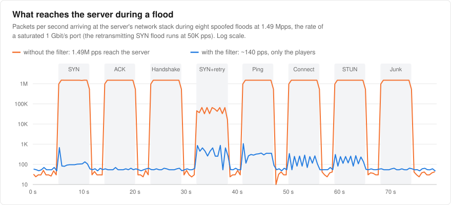
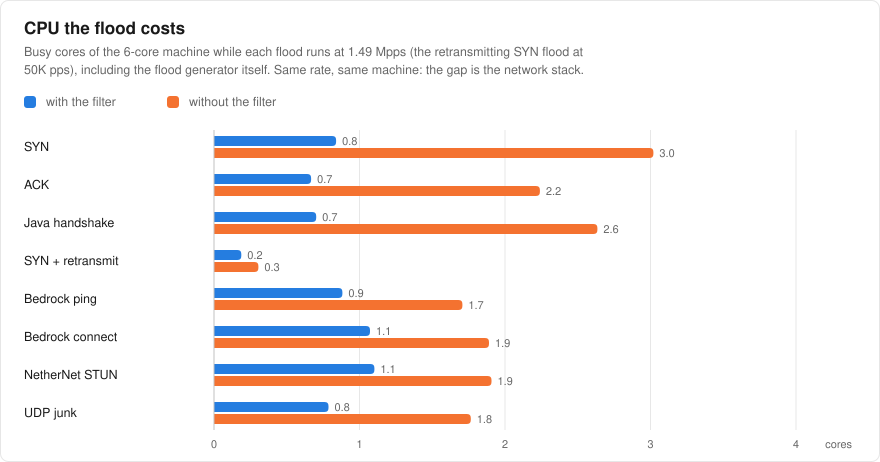
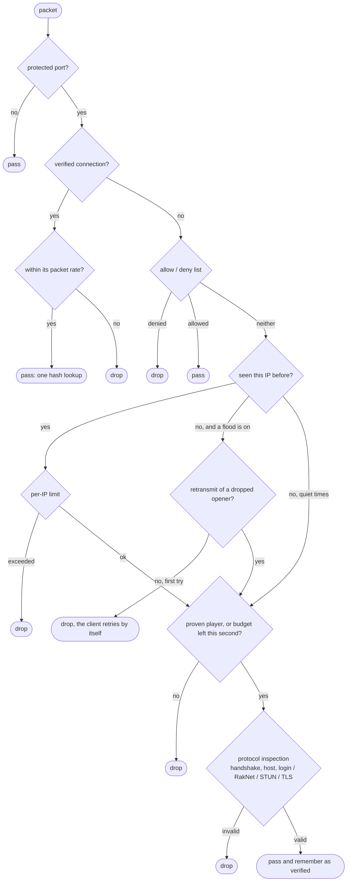

<div align="center">

# minecraft-xdp-guard

**DDoS protection for Minecraft servers that runs inside your network card.**
Java, Bedrock, NetherNet, Simple Voice Chat and IPv6. Floods are dropped
before the kernel, your proxy or your server spends anything on them.

[](../../releases/latest)
[](#telemetry)
[](#telemetry)


[Quick start](#quick-start) ·
[Under attack](#under-attack) ·
[How it works](#how-it-works) ·
[Operating](#operating) ·
[FAQ](#faq) ·
[All options](docs/configuration.md)

</div>

<picture>
  <source media="(prefers-color-scheme: dark)" srcset="https://stats.olune.me/v1/chart.svg?theme=dark">
  
</picture>

## Why

- **Cheap enough to win.** 16-29 ns per packet on every path. On the same
  machine the kernel alone runs out of CPU at 1.9 million SYNs per second;
  with the filter it takes in 9 million.
- **Covers what a public server exposes.** Java handshakes and logins, Bedrock
  RakNet, NetherNet (Bedrock 26.x), Simple Voice Chat, any other TCP or UDP
  port, over IPv4 and IPv6.
- **Players do not notice.** Players who have been online for a few minutes
  skip the attack budgets, restarts and upgrades keep every connection, and a
  crashed loader leaves the filter running.

Based on [Outfluencer/Minecraft-XDP-eBPF](https://github.com/Outfluencer/Minecraft-XDP-eBPF),
which filters Minecraft Java over IPv4. All of its inspection is still here.

## Quick start

You need Linux 5.11 or newer and root. Download the static binary (x86_64,
no dependencies, the BPF program built in):

```bash
curl -fLo xdp-loader https://github.com/regksemx/minecraft-xdp-guard/releases/latest/download/xdp-loader
chmod +x xdp-loader
sudo ./xdp-loader --check    # does this kernel accept the filter?
sudo ./xdp-loader eth0       # the interface players arrive on
```

The first start writes a `config.toml` with every option documented and
protects Java on port 25565. Add the names players connect with, so that
everything aimed at the bare address is dropped:

```toml
[java]
hosts = ["play.example.com", "*.example.com"]
```

To keep it running, install the [systemd unit](deploy/minecraft-xdp.service):

```bash
sudo install -m 755 xdp-loader /usr/local/sbin/xdp-loader
sudo install -d /etc/minecraft-xdp /var/log/minecraft-xdp
sudo install -m 644 config.toml /etc/minecraft-xdp/config.toml
sudo install -m 644 deploy/minecraft-xdp.service /etc/systemd/system/   # set your interface in ExecStart
sudo systemctl enable --now minecraft-xdp
```

### Recipes

Add the blocks for what your server runs; ports are the usual defaults.

<details>
<summary><b>Bedrock through Geyser</b> (RakNet, udp 19132)</summary>

```toml
[bedrock]
start_port = 19132
end_port = 19132
# answer server list pings from the filter with the real server's pong
pong_from = "127.0.0.1:19132"
```
</details>

<details>
<summary><b>NetherNet</b> (Bedrock 26.x: signaling on tcp 19132, WebRTC on udp)</summary>

```toml
[tcp_guard]
start_port = 19132
end_port = 19132

[nethernet]
ice_start_port = 27020
ice_end_port = 27029
```
</details>

<details>
<summary><b>Simple Voice Chat</b> (udp 24454)</summary>

```toml
[voice]
start_port = 24454
end_port = 24454
```
</details>

<details>
<summary><b>IPv6</b></summary>

```toml
[xdp]
# "inspect": the same rules as IPv4. "drop" if players never use IPv6,
# so that it is no way around the filter.
ipv6 = "inspect"
```
</details>

<details>
<summary><b>Attack budgets</b> for a 1 Gbit/s port</summary>

```toml
[attack]
retry_table_slots = 16777216
syn_budget = 6000
login_budget = 300
status_budget = 1500
ping_budget = 3000
udp_session_budget = 300
```

Run with `[metrics] enabled = true` for a few days first and set each budget
to a few times the peak you see without an attack. A full example for a
Java + Bedrock + NetherNet entry node: [`deploy/config.edge.toml`](deploy/config.edge.toml).
</details>

## Under attack

Eight kinds of spoofed floods at 1.49 million packets per second, the rate of
a saturated 1 Gbit/s port, against a test server with and without the filter:

<picture>
  <source media="(prefers-color-scheme: dark)" srcset="docs/charts/flood-reach-dark.svg">
  
</picture>

<picture>
  <source media="(prefers-color-scheme: dark)" srcset="docs/charts/flood-cpu-dark.svg">
  
</picture>

A Bedrock player loses half of their packets during a UDP flood without the
filter and none with it. The price: while a flood of unknown addresses is on,
a player connecting from an address the filter has never seen gets in about a
second later. All numbers, the method and how to reproduce them:
[docs/benchmarks.md](docs/benchmarks.md).

## How it works

| Protected | Transport | What a client has to prove |
|-----------|-----------|----------------------------|
| Minecraft Java | TCP | TCP handshake, valid Minecraft handshake, then status + ping or a login |
| Bedrock (RakNet) | UDP | OpenConnectionRequest 1 and 2 from the same address |
| NetherNet data channels | UDP | STUN binding request first, then only STUN and DTLS |
| TCP guard (NetherNet signaling, others) | TCP | TCP handshake, then a TLS ClientHello or an HTTP request |
| Simple Voice Chat | UDP | the frame of its packets: magic byte, connection id, a payload length that matches the datagram |
| UDP guard (anything else) | UDP | a minimum size and optionally a fixed first byte; the limits do the rest |

Everything else aimed at a protected port is dropped. A connection that
passed costs one hash lookup per packet from then on.



A spoofed flood never retransmits, so during an attack it is stopped by the
challenge at the cost of one array access per packet and leaves nothing in
the tables. Bots with real addresses are held back by the per-IP limits and
the budgets, which proven players do not spend. All state expires lazily
inside the program: no timers, no userspace round trips, preallocated LRU
tables.

<details>
<summary><b>Compared to upstream</b></summary>

| | Upstream | This fork |
|---|:---:|:---:|
| Java handshake / status / login inspection | ✅ | ✅ |
| SYN throttle per IP | ✅ | ✅ plus status, ping and session limits |
| Host name filter (`play.example.com`, `*.example.com`) | | ✅ |
| Bedrock RakNet, pings answered by the filter | | ✅ |
| Bedrock NetherNet (WebRTC data channels, signaling) | | ✅ |
| Simple Voice Chat, generic TCP / UDP guards | | ✅ |
| IPv6 | | ✅ |
| Retransmit challenge, per-second budgets, proven players | | ✅ |
| Allow / deny lists, bans without a restart | | ✅ |
| Restart and upgrade without a gap, filter survives a loader crash | | ✅ |
| `--check` against the verifier before deploying | | ✅ |
| Prometheus metrics | ✅ | ✅ plus Grafana dashboard and alert rules |
| Tests | C unit tests | + in-kernel, end-to-end and load tests with spoofed floods |
</details>

## Operating

**Configuration** lives in `config.toml` (`--config <path>` for another
file). Every option is documented in the file the first start writes and in
[docs/configuration.md](docs/configuration.md). Values are pushed into the
program at load time: a change needs a reload, not a rebuild, and a disabled
feature costs nothing per packet.

| | Filter | Players |
|---|---|---|
| `systemctl reload` (`SIGUSR1`, `SIGHUP`) | stays attached; the new program replaces the old one atomically | stay connected |
| `systemctl restart` | detached for a moment | stay connected |
| `systemctl stop` (`SIGTERM`) | detached, traffic passes unfiltered | stay connected |
| the loader crashes or is killed | stays attached; the restarted loader takes over | stay connected |

Apply a new config or binary with `reload`. Check it first with
`xdp-loader --check -c /etc/minecraft-xdp/config.toml`: it runs the program
through the kernel's verifier without touching the running filter.

**Bans** take effect with the next packet, cut the address's open
connections and survive restarts:

```bash
xdp-loader deny -c /etc/minecraft-xdp/config.toml add --ttl 3600 203.0.113.7   # for an hour
xdp-loader deny -c /etc/minecraft-xdp/config.toml add 198.51.100.0/24          # until removed
xdp-loader deny -c /etc/minecraft-xdp/config.toml list
xdp-loader deny -c /etc/minecraft-xdp/config.toml del 198.51.100.0/24
echo 203.0.113.8 | xdp-loader deny -c /etc/minecraft-xdp/config.toml add -     # from an anti-cheat or a log watcher
```

**Monitoring:** with `[metrics] enabled = true` and an `addr` the loader
serves Prometheus metrics and reports floods in its log (what is dropped and
why). [`deploy/monitoring`](deploy/monitoring) has a scrape job, alert rules
and a Grafana dashboard.

**State** (verified connections, known IPs, bans) is pinned in
`/sys/fs/bpf/minecraft-xdp`. `--reset-state` forgets connections and known
IPs; `xdp-loader detach <interface>` removes the filter of a loader that is
gone.

## Telemetry

Like [bStats](https://bstats.org) for plugins, the loader sends a small
anonymous report every 30 minutes, so that the project can see how many
servers and players it protects. The totals are public:
[stats.olune.me/v1/summary](https://stats.olune.me/v1/summary).

<details>
<summary>A report is exactly this, nothing more</summary>

```json
{
  "v": 1,
  "id": "3f9c2a7e5b1d4c8e9a0f6b2d7e1c5a93",
  "version": "1.0.1",
  "kernel": "6.12.38+deb13-amd64",
  "arch": "x86_64",
  "cpus": 12,
  "mode": "driver",
  "features": ["java", "hosts", "bedrock", "metrics"],
  "players": {"java": 412, "bedrock": 57, "nethernet": 9, "voice": 130},
  "packets": {"incoming": 81234567, "dropped": 80998321},
  "uptime_secs": 86400,
  "interval_secs": 1800
}
```

- `id` is random, made on the first start and kept in `telemetry-id` next to
  the config file. It only tells reports of the same installation apart.
- `players` are the verified connections at that moment, read from the
  filter's own tables; `null` if they are not pinned.
- `packets` counts since the previous report and is only there with
  `[metrics] enabled = true`, because the program counts nothing otherwise.
</details>

No IP addresses, host names, ports or configuration values are sent. The
collector ([`collector/`](collector)) keeps the latest report per id and does
not store or log the address a report came from.

**Turn it off** with `[telemetry] enabled = false`, or with
`MINECRAFT_XDP_TELEMETRY=off` in the environment (`Environment=` in the
systemd unit). The loader says at every start whether and where it reports; a
failed report never affects the filter.

## FAQ

<details>
<summary><b>Players can not connect after setting <code>hosts</code></b></summary>

The name they use is missing from the list. Clients that resolve a SRV record
send the SRV *target* in the handshake, not the name the player typed: list
both, and the IP if players may use it. `minecraft_bad_host` in the metrics
counts the refused handshakes.
</details>

<details>
<summary><b>Does my network card support native XDP?</b></summary>

`ethtool -i <interface>` shows the driver. Native mode works with igb,
ixgbe, i40e, ice, mlx4/5, bnxt, virtio_net and others; the log says
`attached ... in driver mode`. Without it the filter runs in generic mode:
several times slower per packet, still plenty for a 1 Gbit/s port.
</details>

<details>
<summary><b>Bots with real IPs still get in</b></summary>

They have to: a bot with a real address and a valid login looks like a
player. The per-IP limits and the login budget slow them down; telling them
apart is the job of a limbo / anti-bot plugin behind the filter.
</details>

<details>
<summary><b>Can I put SSH or a database behind the TCP guard?</b></summary>

No. The filter drops the bare ACK of the TCP handshake on purpose, so the
server only sees connections whose first data packet passed inspection. That
needs protocols where the client talks first (Minecraft, TLS, HTTP).
</details>

<details>
<summary><b>How does IPv6 work?</b></summary>

By the same rules, in the same tables: IPv6 flows are stored by a hash of
their addresses with a per-boot secret, and the per-IP limits apply to the
/64 of the source. Fragments and packets with more than four extension
headers are dropped for the protected ports. Bedrock pings over IPv6 are
answered by the server, not from the pong cache.
</details>

<details>
<summary><b>Permission errors</b></summary>

Run the loader as root. The state is pinned in `/sys/fs/bpf`, so the bpf
filesystem has to be mounted there (it is on every common distribution).
</details>

## Building and testing

<details>
<summary>Build from source</summary>

Linux, Rust (stable, 1.98 or newer), clang 19 or newer and libbpf headers:

```bash
sudo apt install -y gcc-multilib git libbpf-dev
wget https://apt.llvm.org/llvm.sh && chmod +x llvm.sh && sudo ./llvm.sh 21 all
./build.sh        # target/release/xdp-loader
```

On macOS, or to keep the toolchain off the host, build inside the container:
`dev/run.sh cargo build --release`, or `dev/build-x86_64.sh` for a static
x86_64 binary.
</details>

Every change runs through four layers: the parsers as native C with
ASan/UBSan, the compiled BPF program inside the kernel with crafted packets
(653 checks), the real loader between a client and stand-in servers on a veth
pair (235 checks), and spoofed floods from every CPU while real clients keep
playing (118 checks).

```bash
dev/run.sh                    # everything, inside a container (needs Docker)
cargo test                    # Rust tests + native C tests of the parsers
sudo dev/kernel-test.sh       # the BPF program in the running kernel, packet by packet
sudo dev/kernel-test.sh bench # cost per packet on the important paths
sudo dev/e2e-test.sh          # the real loader between a client and stand-in servers
sudo dev/load-test.sh         # spoofed floods from all cpus while real clients keep playing
dev/run.sh dev/bench/attack.sh # the benchmarks behind docs/benchmarks.md
```

## Credits and license

The original filter and its Java inspection are by
[Outfluencer](https://github.com/Outfluencer); consider supporting the
upstream project. Licensed like upstream: BSD-3-Clause, with the BPF program
in `xdp/` dual-licensed GPL-2.0 OR BSD-3-Clause, see [LICENSE](LICENSE).
