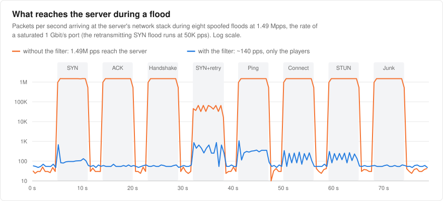
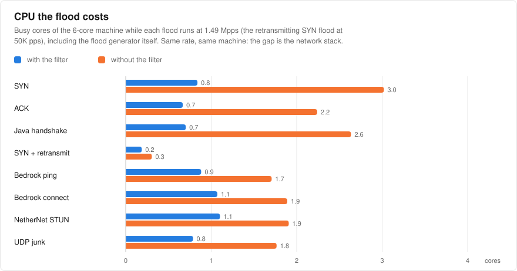
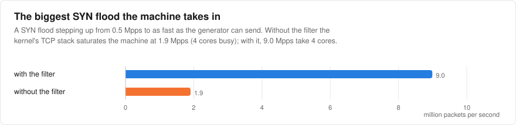
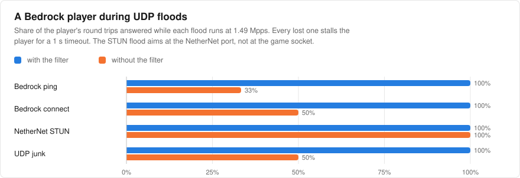
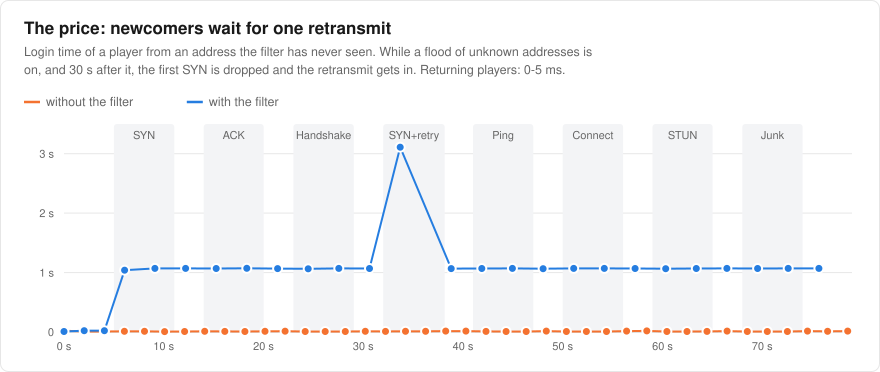
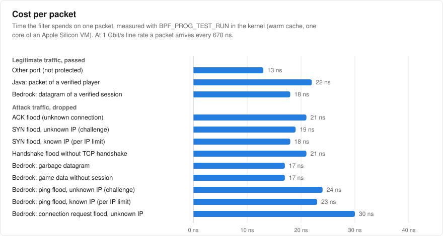

# Benchmarks

Spoofed floods against a test server, each scenario once with the filter and
once without it, while a player keeps playing (a Java connection and a
Bedrock session, one round trip each every 100 ms), logs in again every 2 s,
and newcomers join from addresses never seen before.

Everything here comes from `dev/bench/attack.sh` and is drawn by
`dev/bench/charts.py`; the raw measurements are in [`dev/bench/out`](../dev/bench/out).
Run it yourself with `dev/run.sh dev/bench/attack.sh` (Docker, about five
minutes), then `python3 dev/bench/charts.py`.

**Lab, not production.** Two network namespaces joined by a veth pair inside
a 6-core Linux VM on Apple Silicon (kernel 6.8), the filter in generic (skb)
mode, stand-in servers written in Python. The server namespace has a default
route and no reverse path filter, so like a real server its kernel answers
every spoofed SYN, ping and request instead of discarding them for having no
route back. Absolute numbers depend on the machine; native XDP on a real NIC
is several times cheaper per packet than generic mode on a veth.

## What reaches the server

<picture>
  <source media="(prefers-color-scheme: dark)" srcset="charts/flood-reach-dark.svg">
  
</picture>

With the filter the server sees 57-405 packets per second during the floods:
the player traffic of the test, plus what the budgets let through on purpose
(the retransmitting SYN flood passes the challenge and is then held to the SYN
budget of unproven addresses). The short spike at the start of a flood is the
fraction of a second before the challenge arms.

## CPU

<picture>
  <source media="(prefers-color-scheme: dark)" srcset="charts/flood-cpu-dark.svg">
  
</picture>

Busy cores of the whole machine, including the flood generator. On a veth
pair the receiving side runs on the sender's cpu, so the generator's share
can not be separated cleanly; at the same rate it is the same in both runs.

<picture>
  <source media="(prefers-color-scheme: dark)" srcset="charts/flood-capacity-dark.svg">
  
</picture>

| Target rate | Sent, without / with the filter | Busy cores, without / with |
|---|---:|---:|
| 0.5 Mpps | 499K / 500K pps | 0.9 / 0.5 |
| 1.5 Mpps | 1.50M / 1.50M pps | 3.1 / 0.9 |
| 3 Mpps | 1.91M / 3.00M pps | 4.1 / 1.5 |
| as fast as possible | 1.80M / 8.99M pps | 4.1 / 4.1 |

Without the filter the machine can not take in more than about 1.9 million
SYNs per second: every one of them costs the kernel a SYN cookie and a
SYN-ACK. With the filter the generator itself becomes the limit.

## Players

<picture>
  <source media="(prefers-color-scheme: dark)" srcset="charts/bedrock-player-dark.svg">
  
</picture>

Without the filter a UDP flood aimed at the game port fills the server's
socket, and the Bedrock player's packets drown in it: a third to half of the
round trips are lost, and each lost one stalls the player for the 1 s
timeout, so only 9-10 round trips happen in 6 s instead of 60. With the
filter nothing is lost. The Java player lost nothing in either run (its
connection has a socket of its own), and neither did the player during the
TCP floods.

<picture>
  <source media="(prefers-color-scheme: dark)" srcset="charts/newcomer-login-dark.svg">
  
</picture>

The price of the retransmit challenge: while a flood of unknown addresses is
on, and `challenge_hold_secs` (30 s) after it, an address the filter has
never seen gets in with the retransmit of its first SYN, about 1 s later
(median 1.07 s, 26 logins). During the retransmitting SYN flood one newcomer
needed a second retransmit (3.1 s): that flood passes the challenge and uses
up the SYN budget for unproven addresses, which is what the budget is for. In
the escalating run one newcomer out of 25 did not get in within its 5 s
timeout at 3 Mpps. Returning players log in within 8 ms throughout.

## All floods at a glance

| Flood | Rate sent | Reached the server, without / with | Busy cores, without / with | Bedrock round trips answered, without / with |
|---|---:|---:|---:|---:|
| SYN | 1.49M pps | 1.49M / 103 pps | 3.0 / 0.8 | 60/60 / 60/60 |
| ACK | 1.49M pps | 1.49M / 58 pps | 2.2 / 0.7 | 60/60 / 60/60 |
| Java handshake | 1.49M pps | 1.49M / 57 pps | 2.6 / 0.7 | 60/60 / 60/60 |
| SYN + retransmit | 53K pps | 49K / 405 pps | 0.3 / 0.2 | 59/59 / 61/61 |
| Bedrock ping | 1.49M pps | 1.49M / 327 pps | 1.7 / 0.9 | 3/9 / 60/60 |
| Bedrock connect | 1.49M pps | 1.49M / 174 pps | 1.9 / 1.1 | 5/10 / 60/60 |
| NetherNet STUN | 1.49M pps | 1.49M / 177 pps | 1.9 / 1.1 | 60/60 / 60/60 |
| UDP junk | 1.49M pps | 1.49M / 57 pps | 1.8 / 0.8 | 5/10 / 60/60 |

## Cost per packet

<picture>
  <source media="(prefers-color-scheme: dark)" srcset="charts/cost-per-packet-dark.svg">
  
</picture>

`dev/kernel-test.sh bench`: the compiled program run on one crafted packet
at a time with `BPF_PROG_TEST_RUN`, warm cache, the same packet over and over.
It shows that no path does anything expensive; it is not a throughput test,
and random source addresses on a real server miss the cache more often.
